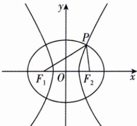

> [!faq]- 必刷题解析
> **【答案】** D
>
> **【解析】**
> 由对称性,不妨设点 P 为两曲线在第一象限的交点,如图所示.

则由椭圆的定义可得 $|PF_{1}|+|PF_{2}|=2a_{1}$ ，由双曲线的定义可得 $|PF_{1}|-|PF_{2}|=2a_{2}$ ，
所以 $|PF_{1}|=a_{1}+a_{2},|PF_{2}|=a_{1}-a_{2}$ 因此 $\cos\frac{\pi}{3}=\frac{|PF_{1}|^{2}+|PF_{2}|^{2}-|F_{1}F_{2}|^{2}}{2|PF_{1}|\cdot|PF_{2}|}$ 即 $\frac{1}{2}=\frac{(a_{1}+a_{2})^{2}+(a_{1}-a_{2})^{2}-(2c)^{2}}{2(a_{1}+a_{2})\cdot(a_{1}-a_{2})}$ 整理得 $a_{1}^{2}+3a_{2}^{2}=4c^{2}$ ，即 $\frac{1}{e_{1}^{2}}+\frac{3}{e_{2}^{2}}=4.$ 点悟：等式两边同时除以 $c^{2}$ ，即得到关于 $e_{1},e_{2}$ 的等式
令 $\frac{1}{e_{1}}=2\cos\theta,\frac{1}{e_{2}}=\frac{2\sqrt{3}}{3}\sin\theta,$ 因此 $\frac{2}{e_{1}}+\frac{3}{e_{2}}=4\cos\theta+2\sqrt{3}\sin\theta=$ $2\sqrt{7}\sin(\theta+\varphi)$ ，其中 $\tan\varphi=\frac{2\sqrt{3}}{3}$
所以当 $\sin(\theta+\varphi)=1$ 时， $\frac{2}{e_{1}}+\frac{3}{e_{2}}$ 有最大值 $2\sqrt{7}$ ，
>
> 故选 **D**.
>
> ---
> **📚 二级结论**
> 椭圆 $C_{1}:\frac{x^{2}}{a^{2}}+\frac{y^{2}}{b^{2}}=1(a>b>0)$ 和双曲线 $C_{2}:\frac{x^{2}}{m^{2}}-\frac{y^{2}}{n^{2}}=1(m>0,n>0)$ 有共同的焦点 $F_{1},F_{2},|F_{1}F_{2}|=2c,e_{1},e_{2}$ 分别是 $C_{1},C_{2}$ 的离心率，若点 P 是它们的公共点， $\angle F_{1}PF_{2}=\theta$ ，则 $e_{1}$ 与 $e_{2}$ 的关系式为 $\frac{\sin^{2}\frac{\theta}{2}}{e_{1}^{2}}+\frac{\cos^{2}\frac{\theta}{2}}{e_{2}^{2}}=1.$

对应题目：[Q070000004400](../Q070000004400.md)

> 来源：2026版 必刷题 数学选择性必修第一册RJA
