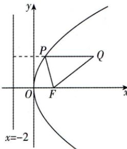

> [!faq]- 必刷题解析
> **【答案】** A
>
> **【解析】**
> 由题意知 $F(2,0)$ ，
记抛物线 C 的准线为 l，则 l:x=-2，
记点 P 到 l 的距离为 d，点 $Q(6,3)$ 到 l 的距离为 $d'$ ,
则 $\left|PQ\right|+\left|PF\right|+\left|QF\right|=\left|PQ\right|+d+\sqrt{(6-2)^{2}+(3-0)^{2}}\geqslant d'+5=8+5=13$ ，当且仅当 P 为 Q 到 l 的垂线与抛物线的交点时，等号成立.
故选 A.

对应题目：[Q070000004418](../Q070000004418.md)

> 来源：2026版 必刷题 数学选择性必修第一册RJA
