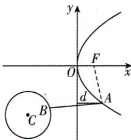

> [!faq]- 必刷题解析
> **【解析】**
> 5 【解析】如图, 设抛物线的焦点为 F, 圆心为 C, 连接 AF, 则 $F(2,0)$ , $C(-6,-6)$ , 又圆 C 的半径 r=3,
由抛物线的定义可得 $d = |AF| - 2$ ，所以 $|AB| + d = |AB| + |AF| - 2$ ，又 $|AB| + |AF| \geqslant |FC| - r = 10 - 3 = 7$ ，当 F, A, B, C 四点共线且 A, B 在线段 FC 上时，等号成立，所以 $|AB| + d$ 的最小值为 7 - 2 = 5.

## 刷提升

对应题目：[Q070000004419](../Q070000004419.md)

> 来源：2026版 必刷题 数学选择性必修第一册RJA
