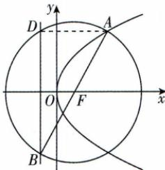

> [!faq]- 2026版 必刷题 数学选择性必修第一册RJA
> **【答案】** B
>
> **【解析】**
> 连接 $AD$ ，因为 $A,F,B$ 三点共线，所以 $AB$ 为圆 $F$ 的直径，则 $AD\bot BD.$ 由抛物线定义知 $\mid AD\mid = \mid AF\mid =$ $\frac{1}{2} |\mathit{AB}|$ ，所以 $\angle ABD = 30^{\circ}$ .因为 $F$ 到准线的距离为6，所以 $\mid AF\mid = \mid BF\mid =$ $2\times 6 = 12.$ 故选B.
> 
