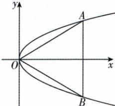

> [!faq]- 必刷题解析
> **【解析】**
> 2 【解析】设抛物线 $y^{2}=2px(p>0)$ 上的点 $A(x_{1},y_{1}), B(x_{2},y_{2})$ ，即有 $y_{1}^{2}=2px_{1}, y_{2}^{2}=2px_{2}$ .

由 $\triangle OAB$ 是正三角形，得 $|OA| = |OB|$ ，则 $x_{1}^{2} + y_{1}^{2} = x_{2}^{2} + y_{2}^{2}$ ，即 $(x_{1}^{2} - x_{2}^{2}) + 2p(x_{1} - x_{2}) = 0$ 整理得 $(x_{1} - x_{2})(x_{1} + x_{2} + 2p) = 0$ ，而 $x_{1} >$
$0, x_{2} > 0, 2p > 0,$ 因此 $x_{1} = x_{2}$ ，由抛物线的对称性得点 $A, B$ 关于 $x$ 轴对称，即 $AB$ 垂直于 $x$ 轴，且 $\angle A O x = 30^{\circ}$ ，不妨令 $y_{1} > 0$ 则 $\frac{y_{1}}{x_{1}} = \tan 30^{\circ} = \frac{\sqrt{3}}{3}$ ，而 $x_{1} = \frac{y_{1}^{2}}{2p}$ ，于是 $y_{1} = 2\sqrt{3} p$ ，即 $|AB| = 2y_{1} = 4\sqrt{3} p$ ，因此 $4\sqrt{3} p = 8\sqrt{3}$ ，所以 $p = 2$ .

对应题目：[Q070000004435](../Q070000004435.md)

> 来源：2026版 必刷题 数学选择性必修第一册RJA
