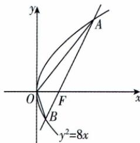

> [!faq]- 必刷题解析
> **【解析】**
> 【解】(1)由题意知 $F\left(\frac{p}{2},0\right)$ ，准线方程为 $x=-\frac{p}{2}$ 。由抛物线定义可知点P到焦点F的距离即为点P到准线的距离，所以 $3+\frac{1}{2}p=5$ ，解得p=4，所以抛物线方程为 $y^{2}=8x$ 。(2)由(1)知，抛物线 $C:y^{2}=8x$ ，直线AB过点(2,0)，可设直线AB的方程为 $x=ty+2$ ， $A(x_{1},y_{1}),B(x_{2},y_{2})$ ，不妨设 $y_{1}>0$ ，联立 $\begin{cases}y^{2}=8x,\\x=ty+2,\end{cases}$ 消x得 $y^{2}-8ty-16=0$ ，所以 $y_{1}y_{2}=-16$ ，则 $y_{2}=\frac{-16}{y_{1}}$ ，所以 $S_{\triangle AOB}=\frac{1}{2}\times2\times|y_{1}-y_{2}|=\left|y_{1}-\frac{-16}{y_{1}}\right|=y_{1}+\frac{16}{y_{1}}\geqslant2\sqrt{16}=8$ ，当且仅当 $y_{1}=\frac{16}{y_{1}}$ ，即 $y_{1}=4$ 时取等号，
所以 $S_{\triangle AOB}$ 的最小值为8.

>
> ---
> **📚 二级结论**
> 设 AB 是过抛物线 $y^{2}=2px(p>0)$ 焦点 F 的一条弦, $A(x_{1},y_{1}), B(x_{2},y_{2})$ , 则 $y_{1}y_{2}=-p^{2}, x_{1}x_{2}=\frac{p^{2}}{4}$ .

## 刷提升

对应题目：[Q070000004443](../Q070000004443.md)

> 来源：2026版 必刷题 数学选择性必修第一册RJA
