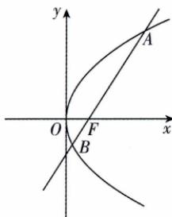

> [!faq]- 2026版 必刷题 数学选择性必修第一册RJA
> **【答案】** B
>
> **【解析】**
> 依题意 $F(1,0)$ ，设直线 $AB$ 的方程为 $x = my + 1(m > 0)$ 由 $\left\{ \begin{array}{l}y^{2} = 4x,\\ x = my + 1, \end{array} \right.$ 得 $y^{2} - 4my - 4 = 0$ ，所以 $y_{A} + y_{B} = 4m,$ 所以 $|AB| = x_A + x_B + p = m(y_A + y_B) + 2+$ $2 = 4m^2 +4 = \frac{16}{3},$ 解得 $m = \frac{\sqrt{3}}{3}$ ，所以直线 $l$ 的斜率为 $\sqrt{3}$ 故选B.
> 
