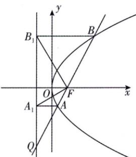

> [!faq]- 2026版 必刷题 数学选择性必修第一册RJA
> **【答案】** ABD
>
> **【解析】**
> 记 $BA$ 与准线 $m$ 交于点 $Q$ .
> 
> 对于 A, 设 $\left|FA\right| = \left|AA_{1}\right| = t, \left|FB\right| = \left|BB_{1}\right| = 3t, \left|AQ\right| = x,$ 由题意得 $\triangle QAA_{1}\sim\triangle QBB_{1}$ ，则 $\frac{\left|QA\right|}{\left|QB\right|}=$ $\frac{|AA_1|}{|BB_1|}$ 即 $\frac{x}{x + 4t} = \frac{t}{3t} \Rightarrow x = 2t$ 故 $\angle A_{1}AQ = 60^{\circ}$ , 故 $k = \sqrt{3}$ , A 正确. 对于 B, 设 $A(x_{1}, y_{1}), B(x_{2}, y_{2})$ , 联立直线 $l: y = k(x - 1)$ 与抛物线方程得 $\left\{ \begin{array}{l} y = k(x - 1), \\ y^{2} = 4x, \end{array} \right.$ 得 $k^{2}x^{2} - (2k^{2} + 4)x + k^{2} = 0, \therefore x_{1} + x_{2} = \frac{2k^{2} + 4}{k^{2}}, x_{1}x_{2} = 1, \Delta > 0,$ $\therefore \frac{1}{|FA|} + \frac{1}{|FB|} = \frac{1}{x_{1} + 1} + \frac{1}{x_{2} + 1} = \frac{x_{1} + x_{2} + 2}{x_{1}x_{2} + (x_{1} + x_{2}) + 1} = 1$ , 故 B 正确. 功思: $\frac{1}{|FA|} + \frac{1}{|FB|} = \frac{2}{p} = \frac{2}{2} = 1$ 对于 C, 若 $k = 1$ , 则 $x_{1} + x_{2} = 6, |AB| = x_{1} + x_{2} + 2 = 8$ , 故 C 错误. 对于 D, $\because \angle BB_{1}F = \angle B_{1}FB, \angle AA_{1}F = \angle A_{1}FA,$ $\therefore \angle B_{1}FB + \angle A_{1}FA = \frac{180^{\circ} - \angle B_{1}BF}{2} + \frac{180^{\circ} - \angle A_{1}AF}{2} = 90^{\circ}$ , 故 D 正确.
>
> 故选 **ABD**.
