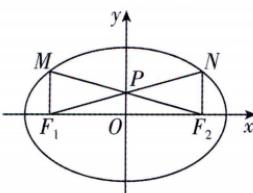

> [!faq]- 必刷题解析
> **【答案】** B
>
> **【解析】**
> 如图,由于 $MF_{1} \parallel NF_{2}, MF_{2}$ 与 $NF_{1}$ 的交点在 y 轴上,结合椭圆的对称性,

故 $MF_{1} \perp F_{1}F_{2}, NF_{2} \perp F_{1}F_{2}$ , 设 $M(-c, y)(y > 0)$ , 代入 $E: \frac{x^{2}}{a^{2}} + \frac{y^{2}}{b^{2}} = 1 (a > b > 0)$ 中, 得 $\frac{c^2}{a^2} + \frac{y^2}{b^2} = 1$ , 解得 $y = \frac{b^2}{a}$ , 故 $M\left(-c, \frac{b^2}{a}\right)$ . 设 $MF_{2}$ 与 $NF_{1}$ 的交点为 $P$ , 则 $P\left(0, \frac{b}{3}\right)$ . 显然 $\triangle MF_{1}F_{2} \sim \triangle POF_{2}$ , 则 $\frac{|OP|}{|MF_{1}|} = \frac{|OF_{2}|}{|F_{1}F_{2}|} = \frac{1}{2}$ , 将 $|MF_{1}| = \frac{b^{2}}{a}, |OP| = \frac{b}{3}$ 代入上式, 得 $\frac{\frac{b}{3}}{\frac{b^{2}}{a}} = \frac{1}{2}$ , 化简得 $\frac{b}{a} =$
得 $4y - (x_{1} + x_{2})x + x_{1}x_{2} = 0$ ，直线 $AB$ 过点 $F(0,1),\therefore x_1x_2 = -4,\therefore y_0 = 2+$ $y_{2}$ ，又 $\because |FB| = y_2 + 1 = y_0 - 2 + 1 = y_0-$ $1,|FE| = y_0 - 1,\therefore |FB| = |FE|$ ，B选项正确.
对于C，直线 $l$ 的方程可化为 $y = \frac{x_1x}{2}+$ $2 + y_{2} = \frac{x_{1}x}{2} + 2 + \frac{x_{2}^{2}}{4} = \frac{x_{1}x}{2} + 2 + \frac{4}{x_{1}^{2}}$ ，即 $x_{1}x - 2y + 4 + \frac{8}{x_{1}^{2}} = 0$ ，则 $|BD| =$ $\sqrt{1 + \left(\frac{x_1}{2}\right)^2}|x_2 - x_3|$ ，由点到直线的距离公式可得点 $A$ 到直线 $l$ 的距离 $d = \frac{\left|x_1^2 - 2y_1 + 4 + \frac{8}{x_1^2}\right|}{\sqrt{x_1^2 + 4}}$ $\therefore \triangle ABD$ 的面积 $S = \frac{1}{2}\sqrt{1 + \left(\frac{x_1}{2}\right)^2}\cdot$ $|x_{2} - x_{3}|\cdot \frac{|x_{1}^{2} - 2y_{1} + 4 + \frac{8}{x_{1}^{2}}|}{\sqrt{x_{1}^{2} + 4}}$ $= \frac{1}{4}|x_{2} - x_{3}|\cdot \left|2y_{1} + 4 + \frac{2}{y_{1}}\right|$
专题5 求离心率的值或取值范围 $\frac{2}{3}$ 即 $e = \frac{c}{a} = \sqrt{\frac{c^2}{a^2}} = \sqrt{\frac{a^2 - b^2}{a^2}} = \sqrt{1 - \left(\frac{b}{a}\right)^2} = \sqrt{1 - \frac{4}{9}} = \frac{\sqrt{5}}{3}$ .
>
> 故选 **B**.

对应题目：[Q070000004468](../Q070000004468.md)

> 来源：2026版 必刷题 数学选择性必修第一册RJA
