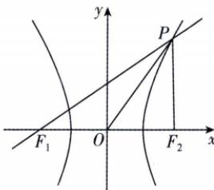
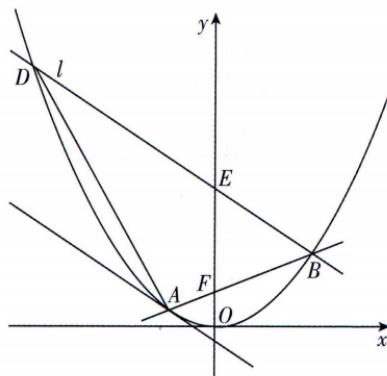

> [!faq]- 必刷题解析
> **【答案】** D
>
> **【解析】**
> 如图.

由题意得 $S_{\triangle F_2PO} = S_{\triangle F_1PO} = \frac{1}{2} |PF_1| \cdot a = 2a^2$ ，故 $|PF_1| = 4a$ ，由双曲线定义得 $|PF_1| - |PF_2| = 2a$ ，所以 $|PF_2| = 2a$ ，在 $\triangle PF_1F_2$ 中，由余弦定理得 $\cos \angle PF_1O = \frac{|PF_1|^2 + |F_1F_2|^2 - |PF_2|^2}{2|PF_1| \cdot |F_1F_2|} = \frac{16a^2 + 4c^2 - 4a^2}{2 \times 4a \cdot 2c} = \frac{b}{c}$ ，点悟：由 $|OF_1| = c$ ，点 $O$ 到直线 $l$ 的距离为 $a$ ，可知 $\cos \angle PF_1O = \frac{\sqrt{c^2 - a^2}}{c} = \frac{b}{c}$ 化简得 $3a^2 + c^2 = 4ab$ ，又 $c^2 = a^2 + b^2$ ，所$= |x_{1} - x_{2}| \cdot \left|y_{1} + 2 + \frac{1}{y_{1}}\right|$ $= \left|x_{1} + \frac{4}{x_{1}}\right| \cdot \left|y_{1} + 2 + \frac{1}{y_{1}}\right|$ $= \left|\frac{(x_1^2 + 4)(y_1 + 1)^2}{x_1y_1}\right|$ $= \frac{(4y_1 + 4)(y_1 + 1)^2}{2y_1\sqrt{y_1}} = \frac{2(y_1 + 1)^3}{y_1\sqrt{y_1}} \geqslant$ $\frac{2(2\sqrt{y_1})^3}{y_1\sqrt{y_1}} = 16$ ，当且仅当 $y_{1} = 1$ 时取等号，C选项正确.
对于D, $y_{1}y_{2} = \frac{x_{1}^{2}}{4} \cdot \frac{x_{2}^{2}}{4} = \left(\frac{x_{1}x_{2}}{4}\right)^{2} = 1$ ，D选项正确. 故选BCD.

以 $4a^{2} + b^{2} - 4ab = 0$ 方程两边同时除以 $a^2$ ，得 $4+$ $\left(\frac{b}{a}\right)^2 -4\cdot \frac{b}{a} = 0,$ 解得 $\frac{b}{a} = 2$ ，所以离心率 $e = \sqrt{1 + \frac{b^2}{a^2}} = \sqrt{5}.$
>
> 故选 **D**.

对应题目：[Q070000004469](../Q070000004469.md)

> 来源：2026版 必刷题 数学选择性必修第一册RJA
