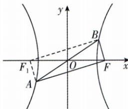

> [!faq]- 必刷题解析
> **【答案】** A
>
> **【解析】**
> 如图，设双曲线的左焦点为 $F_{1}$ ，连接 $AF_{1},BF_{1}$ ，由双曲线的对称性可知，四边形 $AFBF_{1}$ 为平行四边形，又 $\overrightarrow{FA}\cdot \overrightarrow{FB} = 0$ ，所以 $FA\bot FB$ ，所以平行四边形 $AFBF_{1}$ 为矩形，故 $|AB| = |FF_1| = 2c.$ 设 $|AF_1| = n,|AF| = m$ ，则 $|BF| = n,$
在 Rt $\triangle ABF$ 中， $m-n=2a, m^{2}+n^{2}=4c^{2}$ ，所以 $2mn=4c^{2}-4a^{2}=4b^{2}$ ，则 $mn=2b^{2}$ ，
所以 $\frac{m}{n}+\frac{n}{m}=\frac{m^{2}+n^{2}}{mn}=\frac{2c^{2}}{b^{2}}$ ，令 $\frac{m}{n}=t$ ，得 $t+\frac{1}{t}=\frac{2c^{2}}{b^{2}}$ 又由 $|FB|<|FA|\leqslant3|FB|$ ，得 $\frac{m}{n}=t\in(1,3]$ ，
因为对勾函数 $y=t+\frac{1}{t}$ 在 $(1,3]$ 上单调递增，所以 $\frac{2c^{2}}{b^{2}}=t+\frac{1}{t}\in\left(2,\frac{10}{3}\right]$ ，
所以 $\frac{c^{2}}{b^{2}}\in\left(1,\frac{5}{3}\right]$ ，即 $\frac{a^{2}}{b^{2}}+1=\frac{a^{2}+b^{2}}{b^{2}}=\frac{c^{2}}{b^{2}}\in\left(1,\frac{5}{3}\right]$ ，则 $\frac{a^{2}}{b^{2}}\in\left(0,\frac{2}{3}\right]$ ，故 $\frac{b^{2}}{a^{2}}\in\left[\frac{3}{2},+\infty\right)$ ，
所以 $e = \frac{c}{a} = \sqrt{1 + \frac{b^{2}}{a^{2}}} \in \left[\frac{\sqrt{10}}{2}, +\infty\right)$ ，所以双曲线 C 的离心率的取值范围是 $\left[\frac{\sqrt{10}}{2}, +\infty\right)$ . 故选 A.

对应题目：[Q070000004474](../Q070000004474.md)

> 来源：2026版 必刷题 数学选择性必修第一册RJA
