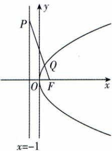

> [!faq]- 2026版 必刷题 数学选择性必修第一册RJA
> **【答案】** D
>
> **【解析】**
> 依题意得 $\frac{p}{2}=1, F(1,0)$ ，准线 l 的方程为 x=-1.
> 因为点 P 是 l 上一点，所以设点 $P(-1, t)$ ， $Q(x_{0}, y_{0})$ ，则 $\overrightarrow{FP}=(-2, t)$ ， $\overrightarrow{FQ}=(x_{0}-1,y_{0})$ ，
> 因为 $\overrightarrow{FP}=4\overrightarrow{FQ}$ ，所以 $-2=4(x_{0}-1)$ ，解得 $x_0 = \frac{1}{2}$ . 又 $Q$ 是直线 $PF$ 与 $C$ 的交点, 所以由抛物线的定义可得 $|FQ| = x_0 + 1 = \frac{3}{2}$ . 故选D.
> 
