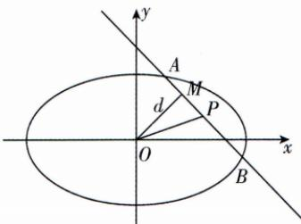

> [!faq]- 2026版 必刷题 数学选择性必修第一册RJA
> **【答案】** B
>
> **【解析】**
> 由题意得 $2a = 2\sqrt{6}, b = \sqrt{2}$ ，则 $a = \sqrt{6}, b = \sqrt{2}, c = \sqrt{a^2 - b^2} = 2$ ，所以椭圆方程为 $\frac{x^2}{6} + \frac{y^2}{2} = 1$ ，因为 $\frac{\left(\frac{3}{2}\right)^2}{6} + \frac{\left(\frac{1}{2}\right)^2}{2} = \frac{1}{2} < 1$ ，所以 [192]
> $P\left(\frac{3}{2},\frac{1}{2}\right)$ 在椭圆内，可知直线 AB 与椭圆总有两个交点，
> 因为 $\overrightarrow{PA} + \overrightarrow{PB} = 0$ ，所以点 P 为线段 AB 的中点。
> 设 $A(x_{1},y_{1}), B(x_{2},y_{2})$ ，显然 $x_{1} \neq x_{2}$ ，则 $x_{1} + x_{2} = 3, y_{1} + y_{2} = 1$ 由 $\left\{\begin{aligned}\frac{x_{1}^{2}}{6}+\frac{y_{1}^{2}}{2}=1,\\ \frac{x_{2}^{2}}{6}+\frac{y_{2}^{2}}{2}=1,\end{aligned}\right.$ 可得 $\frac{x_{2}^{2}-x_{1}^{2}}{6}+\frac{y_{2}^{2}-y_{1}^{2}}{2}=0,$ 则 $(x_{2}+x_{1})(x_{2}-x_{1})+3(y_{2}+y_{1})(y_{2}-y_{1})=0$ ，即 $3(x_{2}-x_{1})+3(y_{2}-y_{1})=0$ ，
> 所以 $\frac{y_{2}-y_{1}}{x_{2}-x_{1}}=-1$ ，即直线AB的斜率k=-1，
> 所以直线AB的方程为 $y-\frac{1}{2}=-(x-\frac{3}{2})$ ，即 $x+y-2=0$ 。
> 因为M为直线AB上任意一点，
> 所以|OM|的最小值为点O到直线AB
> 的距离，即 $d=\frac{|0+0-2|}{\sqrt{1^{2}+1^{2}}}=\sqrt{2}$ ，故选B.
> 
