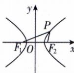

> [!faq]- 必刷题解析
> **【答案】** A
>
> **【解析】**
> 不妨设双曲线的焦点在 x 轴上, 如图, 由双曲线的定义得, $\left|PF_{1}\right| - \left|PF_{2}\right| = 2a$ , 又 $\left|PF_{1}\right| = 3 \left|PF_{2}\right|$ , 所以 $\left|PF_{2}\right| = a, \left|PF_{1}\right| = 3a$ , 所以在 $\triangle F_{1}PF_{2}$ 中, 有 $\left|F_{1}F_{2}\right|^{2} = \left|PF_{1}\right|^{2} + \left|PF_{2}\right|^{2} - 2\left|PF_{1}\right| \cdot \left|PF_{2}\right| \cos \angle F_{1}PF_{2}$ , 即 $4c^{2} = 9a^{2} + a^{2} - 2 \cdot 3a \cdot a \cos 60^{\circ}$ , 化简得 $4c^{2} = 7a^{2}$ , 即 $\frac{c^{2}}{a^{2}} = \frac{7}{4}$ , 所以离心率 $e = \frac{c}{a} = \sqrt{\frac{7}{4}} = \frac{\sqrt{7}}{2}$ , 故选 A.

对应题目：[Q070000004519](../Q070000004519.md)

> 来源：2026版 必刷题 数学选择性必修第一册RJA
