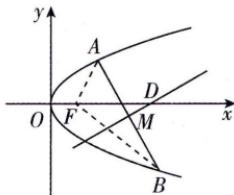

> [!faq]- 2026版 必刷题 数学选择性必修第一册RJA
> **【解析】**
> 2 【解析】设 $A(x_{1},y_{1}),B(x_{2},y_{2})$ ，线段 $AB$ 的中点为 $M(x_0,y_0)$ ，易知直线 $AB$ 的斜率存在且不为0.设直线 $AB$ 的斜率为 $k(k\neq 0)$ ，则 $\left\{ \begin{array}{l}y_1^2 = 2px_1,\\ y_2^2 = 2px_2 \end{array} \right.\Rightarrow y_1^2 -y_2^2 = 2p(x_1 - x_2)$ ，故 $k =$ $\frac{y_1 - y_2}{x_1 - x_2} = \frac{2p}{y_1 + y_2} = \frac{p}{y_0}.$ 则 $k_{MD} = \frac{y_0 - 0}{x_0 - 4} = \frac{y_0}{x_0 - 4} = -\frac{y_0}{p}\Rightarrow x_0 = 4 - p.$ 设 $C$ 的焦点为 $F$ ，连接 $AF,BF$ ，则有 $|AF| + |BF| = x_1 + x_2 + p = 2x_0 + p = 8 - p.$ 又因为 $|AB|$ 的最大值为6，所以根据抛物线性质和三角形三边关系知， $|AB|\leqslant |AF| + |BF| = 8 - p = 6$ ，则 $p = 2.$
> 
> $$
> C: 3 x ^ {2} - y ^ {2} = m ^ {2}
> $$
