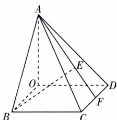

> [!faq]- 必刷题解析
> **【答案】** B
>
> **【解析】**
> 如图, 连接 AE 并延长交 CD 于点 F, ∵ E 为 $\triangle ACD$ 的重心, 则 F 为 CD 的中点, 且 $\overrightarrow{AE} = \frac{2}{3}\overrightarrow{AF}, \therefore \overrightarrow{BE} = \overrightarrow{AE} - \overrightarrow{AB} = \frac{2}{3}\overrightarrow{AF} - \overrightarrow{AB} = \frac{2}{3} \times \frac{1}{2} (\overrightarrow{AC} + \overrightarrow{AD}) - \overrightarrow{AB} = \frac{1}{3}\overrightarrow{AC} + \frac{1}{3}\overrightarrow{AD} - \overrightarrow{AB} = -a + \frac{1}{3}b + \frac{1}{3}c.$ 故选 B.

对应题目：[Q070000004537](../Q070000004537.md)

> 来源：2026版 必刷题 数学选择性必修第一册RJA
