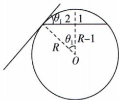
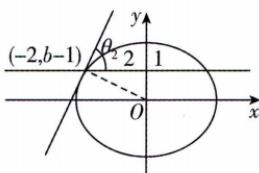

> [!faq]- 必刷题解析
> **【答案】** AD
>
> **【解析】**
> 由题意知,若将水滴轴截面看成圆的一部分,圆的半径为 R,如图所示,

则 $R^{2}=(R-1)^{2}+4$ ，解得 $R=\frac{5}{2}$ ，A 正确；
所以 $\tan\theta_{1}=\frac{2}{R-1}=\frac{4}{3}$ ，故 B 错误；
若将水滴轴截面看成椭圆的一部分，
设椭圆方程为 $\frac{x^{2}}{a^{2}}+\frac{y^{2}}{b^{2}}=1(a>b>0)$ ，如图所示，

则切点坐标为 $(-2,b-1)$ ,则椭圆 $\frac{x^2}{a^2} +\frac{y^2}{b^2} = 1$ 上一点 $(-2,b - 1)$ 处的切线方程为 $\frac{-2x}{a^2} +\frac{(b - 1)y}{b^2} = 1,$ 所以椭圆的切线方程的斜率为 $k_{2} =$ $\tan \theta_{2} = \frac{2b^{2}}{a^{2}(b - 1)}$ 将切点坐标 $(-2,b - 1)$ 代入椭圆方程可得 $\frac{4}{a^2} +\frac{(b - 1)^2}{b^2} = 1$ ，解得 $\frac{4b^2}{a^2} = 2b - 1,$ 所以 $\tan \theta_2 = \frac{2b^2}{a^2(b - 1)} = \frac{\frac{1}{2}(2b - 1)}{b - 1} =$ $\frac{1}{2}\Big(2 + \frac{1}{b - 1}\Big)$ ，又因为 $b <   R = \frac{5}{2},$ 所以 $\tan \theta_{2} = \frac{1}{2}\left(2 + \frac{1}{b - 1}\right) > \frac{4}{3} =$ $\tan \theta_{1}$ ，即 $\tan \theta_2 > \tan \theta_1$ ，又 $\theta_{1},\theta_{2}\in$ $[0,\frac{\pi}{2} ]$ ，所以 $\theta_{1} <   \theta_{2}$ ，故C错误，D正确.
>
> 故选 **AD**.

对应题目：[Q070000004544](../Q070000004544.md)

> 来源：2026版 必刷题 数学选择性必修第一册RJA
