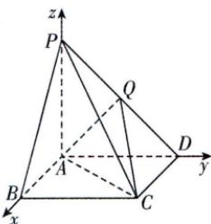

> [!faq]- 2026版 必刷题 数学选择性必修第一册RJA
> **【解析】**
> (1)【证明】若选①,因为平面 $PAD \perp$ 平面 ABCD,且平面 $PAD \cap$ 平面 ABCD = AD,又 $PA \subset$ 平面 PAD, $PA \perp AD$ ,
> 所以 $PA \perp$ 平面 ABCD.
> 若选②, 因为 $PA \perp AB, PA \perp AD, AB \cap AD = A, AB, AD \subset$ 平面 ABCD,
> 所以 $PA \perp$ 平面 ABCD.
> (2)【解】由(1)知 $PA \perp$ 平面 ABCD, 且 $AB \perp AD$ , 即 AB, AD, AP 两两垂直,
> 以 A 为原点, AB, AD, AP 所在直线分别为 x, y, z 轴, 建立如图所示的空间直角坐标系,
> 
> 则 $P(0,0,2)$ , $A(0,0,0)$ , $Q(0,1,1)$ , $C(2,2,0)$ ,
> 所以 $\overrightarrow{AC}=(2,2,0),\overrightarrow{AQ}=(0,1,1)$ ,
> 由(1)知平面 ABCD 的一个法向量为 $\overrightarrow{AP}=(0,0,2)$ .
> 设平面 ACQ 的法向量为 $\boldsymbol{n}=(x,y,z)$ ,
> 则 $\left\{\begin{aligned}&n\cdot\overrightarrow{AC}=2x+2y=0,\\ &n\cdot\overrightarrow{AQ}=y+z=0,\end{aligned}\right.$
> 即 $\left\{\begin{aligned}x+y=0,\\ y+z=0,\end{aligned}\right.$ 令y=1，则 $n=(-1,1,-1)$ .
> 设平面 ACQ 与平面 ABCD 的夹角为 $\theta$ ,
> 则 $\cos\theta=\frac{|\overrightarrow{AP}\cdot\boldsymbol{n}|}{|\overrightarrow{AP}||\boldsymbol{n}|}=\frac{|-2|}{2\times\sqrt{3}}=\frac{\sqrt{3}}{3}$ 所以平面 ACQ 与平面 ABCD 夹角的余弦值为 $\frac{\sqrt{3}}{3}$ .
> (3)【解】由已知得 $B(2,0,0)$ , $\overrightarrow{AB} = (2,0,0)$ ,
> 所以点 B 到平面 ACQ 的距离为 $\frac{|\overrightarrow{AB}\cdot\boldsymbol{n}|}{|\boldsymbol{n}|}=\frac{|-2|}{\sqrt{3}}=\frac{2\sqrt{3}}{3}.$
