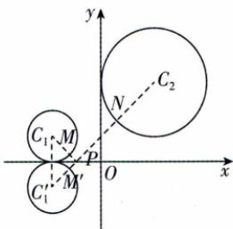

> [!faq]- 2026版 必刷题 数学选择性必修第一册RJA
> **【答案】** A
>
> **【解析】**
> 圆 $C_{1}:(x+2)^{2}+(y-1)^{2}=$ 1, 圆心为 $C_{1}(-2,1)$ ，半径 $r_{1}=1$ ，
> 圆 $C_{2}:(x-2)^{2}+(y-3)^{2}=4$ ，圆心为 $C_{2}(2,3)$ ，半径 $r_{2}=2$ ，如图，
> 
> 圆 $C_1$ 关于 $x$ 轴的对称圆为圆 $C_1'$ : $(x + 2)^2 + (y + 1)^2 = 1$ , 圆心 $C_1'(-2, -1)$ , 连接 $C_1'C_2$ 交 $x$ 轴于点 $P$ , 交圆 $C_1'$ 于点 $M'$ , 交圆 $C_2$ 于点 $N$ , 连接 $C_1P$ 交圆 $C_1$ 于点 $M$ , 此时 $|PM| + |PN|$ 最小, 故 $|PM| + |PN|$ 的最小值为 $|PM'| + |PN| = |C_1'C_2| - r_1 - r_2 = \sqrt{(2 + 2)^2 + (3 + 1)^2} - 1 - 2 = 4\sqrt{2} - 3$ .
>
> 故选 **A**.
