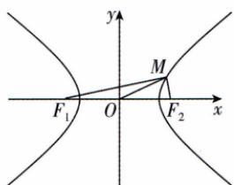

> [!faq]- 必刷题解析
> **【答案】** A
>
> **【解析】**
> 不妨设点 $M$ 在双曲线的右支上，如图所示.设 $\mid MF_1\mid = m,$ $|MF_{2}| = n$ ，则 $\left\{ \begin{array}{l}m - n = 2a①,\\ m^2 +n^2 = 4c^2②,\\ \frac{1}{4} mn = \frac{a^2}{18} ③, \end{array} \right.$ 由 $①$ 得 $m^2 +n^2 -2mn = 4a^2$ .将 $②③$ 代入即可得 $4c^{2} - \frac{4}{9} a^{2} = 4a^{2}$ 故 $4c^{2} = \frac{40}{9} a^{2}$ ，所以 $\frac{c^2}{a^2} = \frac{10}{9},$ 所以离心率 $e = \frac{c}{a} = \frac{\sqrt{10}}{3}$ .故选A.

对应题目：[Q070000004557](../Q070000004557.md)

> 来源：2026版 必刷题 数学选择性必修第一册RJA
