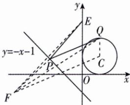

> [!faq]- 2026版 必刷题 数学选择性必修第一册RJA
> **【答案】** ACD
>
> **【解析】**
> 对于 A, 直线 $l: kx + y + 2k - 1 = 0$ , 即 $k(x + 2) + y - 1 = 0$ ,
> 令 $x+2=0$ ，则 y-1=0，解得 x=-2, y=1，所以直线 l 恒过定点 $(-2,1)$ ，故 A 正确；
> 对于 B, 若圆 C 关于直线 l 对称，则直线 l 过圆心 C(1,1)，所以 $k+1+2k-1=0$ ，解得 k=0，故 B 错误；
> 对于 C, 若直线 l 与圆 C 相切，则圆心 C(1,1) 到直线的距离等于半径 1，
> 即 $\frac{|k+1+2k-1|}{\sqrt{k^{2}+1}}=1$ ，解得 $k=\pm\frac{\sqrt{2}}{4}$ ，故 C 正确；
> 对于 D, 当 k=1 时, 直线 $l: x+y+1=0$ , 设点 E(0,3) 关于直线 l 的对称点为 F ( $x_{0}, y_{0}$ ), 如图, 连接 FE, FP, FQ, FC, QC,
> 则有 $\left\{\begin{aligned}\frac{y_{0}-3}{x_{0}-0}&=1,\\ \frac{x_{0}}{2}&+\frac{y_{0}+3}{2}+1=0,\end{aligned}\right.$ 解得 $\left\{\begin{aligned}x_{0}&=-4,\\ y_{0}&=-1,\end{aligned}\right.$ 即 $F(-4,-1)$ ,
> 所以 $|EP| + |PQ| = |FP| + |PQ| \geqslant$ $|FQ| \geqslant |FC| - |CQ|$ ，当且仅当 F, P, Q，
> 故黑板：灵活运用三角形两边之和
> 大于第三边，两边之差小于第三边
> C 四点共线，且排列顺序为 F, P, Q, C
> 时取得等号，所以 $|EP| + |PQ|$ 的最小值为 $|FC|-1 = \sqrt{29}-1$ ，故 D 正确。故选 ACD.
> 
