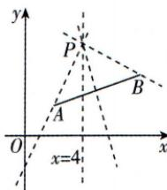

> [!faq]- 必刷题解析
> **【解析】**
> $\left(-\infty,-\frac{1}{2}\right]\cup[2,+\infty)$ 【解析】直线 l:mx-y+6-4m=0，
即 $m(x-4)-(y-6)=0$ 令 $\left\{\begin{aligned}x-4&=0,\\ y-6&=0,\end{aligned}\right.$ 则 $\left\{\begin{aligned}x&=4,\\ y&=6,\end{aligned}\right.$ 即直线 l 过定点 $P(4,6)$ ，且斜率 k=m，
则 $k_{PA}=\frac{6-2}{4-2}=2, k_{PB}=\frac{6-4}{4-8}=-\frac{1}{2}.$ 根据题意，结合图形可得 $k \geqslant 2$ 或 $k \leqslant -\frac{1}{2}$ ，即 $m \geqslant 2$ 或 $m \leqslant -\frac{1}{2}$ .
故实数 m 的取值范围为 $(-∞, -\frac{1}{2}]∪[2,+∞)$ .

对应题目：[Q070000004563](../Q070000004563.md)

> 来源：2026版 必刷题 数学选择性必修第一册RJA
