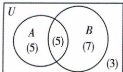

> [!faq]- 必刷题解析
> **【答案】** C
>
> **【解析】**
> 设这 20 名同学构成全集 U, 其中擅长语文的同学构成集合 A, 擅长英语的同学构成集合 B,

>
> ---
> **✨ 巧思**
> 可以将 Venn 图拆分成互不相交的几个区域，再对每个区域进行编号，然后将数值标记在区域内再进行计算
则 $\text{card}(U)=20, \text{card}(A)=10, \text{card}(B)=12, \text{card}(A\cap B)=5,$ ∴ $\text{card}(A \cup B) = \text{card}(A) + \text{card}(B) - \text{card}(A \cap B) = 10 + 12 - 5 = 17,$ ∴ $\text{card}(\complement_U(A \cup B)) = 20 - 17 = 3,$ ∴ 语文和英语均不擅长的同学的人数为

对应题目：[Q070000005277](../Q070000005277.md)

> 来源：2026版 高中必刷题数学必修第一册
