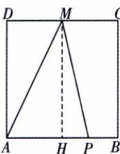
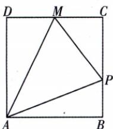
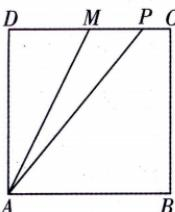

> [!faq]- 2026版 高中必刷题数学必修第一册
> **【答案】** A
>
> **【解析】**
> 当 $0 \leqslant x \leqslant 1$ 时，P 在 AB 上，如图①，过点 M 作 $MH \perp AB$ 于点 H，则 MH = 1，故 $y = \frac{1}{2} AP \cdot MH = \frac{1}{2} x, y$ 随 x 的增大而增大；
> 
> 图①
> 当 $1 < x < 2$ 时， $P$ 在 $BC$ 上，如图②，此时 $y = 1 \times 1 - S_{\triangle ADM} - S_{\triangle APB} - S_{\triangle CPM} = 1 - \frac{1}{2} \times 1 \times \frac{1}{2} - \frac{1}{2}(x - 1) - \frac{1}{2} \times \frac{1}{2}(2 - x) = \frac{3}{4} - \frac{1}{4} x, y$ 随 $x$ 的增大而减小；
> 
> 图②
> 当 $2 \leqslant x \leqslant \frac{5}{2}$ 时, $P$ 在 $CM$ 上, 如图③, 此时 $PM = \frac{5}{2} - x, y = \frac{1}{2} PM \cdot AD = \frac{1}{2}\left(\frac{5}{2} - x\right) = \frac{5}{4} - \frac{1}{2} x, y$ 随 $x$ 的增大而减小.
> 
> 图③
> 综上可知,函数图象分为三段,每一段均为一次函数图象,结合增减趋势可知 A 正确,B,C,D 错误.
>
> 故选 **A**.
