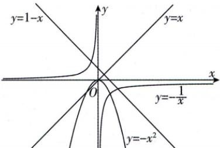

> [!faq]- 必刷题解析
> **【答案】** ABC
>
> **【解析】**
> 作出 $y=-\frac{1}{x}, y=x, y=-x^{2}$ ，y=1-x 的图象如图所示，则由函数的图象知 $y=-\frac{1}{x}, y=x, y=-x^{2}$ 在 $(-∞,0)$ 上单调递增，y=1-x 在 $(-∞,0)$ 上单调递减。故选 ABC.

对应题目：[Q070000005581](../Q070000005581.md)

> 来源：2026版 高中必刷题数学必修第一册
