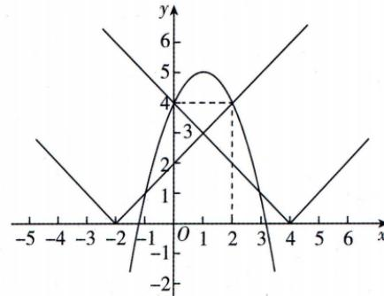

> [!faq]- 必刷题解析
> **【答案】** A
>
> **【解析】**
> $y=4+2x-x^{2}=-(x-1)^{2}+5$ 在 $[-3,3]$ 上的最大值为 5，由 $4+2x-x^{2}=4$ ，解得 x=2 或 x=0，所以当 $x\in(0,2)$ 时， $y=4+2x-x^{2}>4$ ，所以要使函数 $f(x)$ 的最大值为 4，则根据定义可知当 $t\leqslant1$ 时， $y=|x-t|$ 的图象必经过点 $(2,4)$ ，如图，即 x=2 时， $|2-t|=4$ ，此时解得 t=-2，符合题意；当 t>1 时， $y=|x-t|$ 的图象必经过点 $(0,4)$ ，即 x=0 时， $|0-t|=4$ ，解得 t=4，符合题意。故 t=-2 或 4。故选 A.

对应题目：[Q070000005613](../Q070000005613.md)

> 来源：2026版 高中必刷题数学必修第一册
