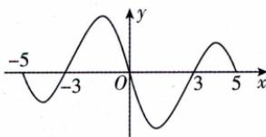

> [!faq]- 2026版 高中必刷题数学必修第一册
> **【答案】** B
>
> **【解析】**
> 因为函数 $f(x)$ 是奇函数, 所以 $y=f(x)$ 在 $[-5,5]$ 上的图象关于坐标原点对称, 由 $y=f(x)$ 在 $x\in[0,5]$ 上的图象, 知它在 $[-5,0]$ 上的图象, 如图所示.
> 
> 所以由图可知使 $f(x) < 0$ 的 $x$ 的取值范围为 $(-5, -3) \cup (0, 3)$ .
>
> 故选 **B**.
