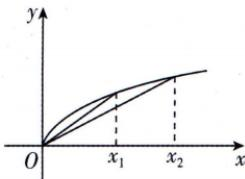

> [!faq]- 必刷题解析
> **【答案】** BC
>
> **【解析】**
> 设幂函数 $f(x)=x^{\alpha}$ ，则有 $\left(\frac{1}{8}\right)^{\alpha}=2^{-3\alpha}=\frac{\sqrt{2}}{4}=2^{-\frac{3}{2}}$ ，解得 $\alpha=\frac{1}{2}$ ，所以 $f(x)=\sqrt{x}(x\geqslant0)$ .
作出函数 $f(x)$ 的大致图象如图所示，由其图象知图象上的点与原点连线所在直线的倾斜程度随x的增大而减小，即 $\frac{f(x_{2})}{x_{2}}<\frac{f(x_{1})}{x_{1}}$ ，即 $x_{1}f(x_{2})<x_{2}f(x_{1})$ ，所以B,C正确.

对应题目：[Q070000005691](../Q070000005691.md)

> 来源：2026版 高中必刷题数学必修第一册
