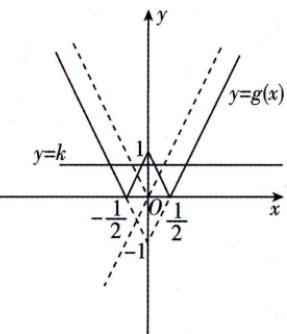

> [!faq]- 必刷题解析
> **【答案】** C
>
> **【解析】**
> 如图, 将直线 y=2x 位于 x 轴下方的部分翻折到 x 轴上方, 再向下平移 1 个单位长度, 得到 $y=2|x|-1$ 的图象, 再将其位于 x 轴下方的图象翻折到 x 轴上方, 即得 $g(x)=|2|x|-1|$ 的图象, 则方程 $|2|x|-1|-k=0$ 有 4 个不同的根的充要条件为 $g(x)=|2|x|-1|$ 的图象与直线 y=k 有 4 个公共点, 即 0<k<1, 结合选项可知其成立的一个充分不必要条件为 $\frac{1}{2} \leqslant k < 1$ , 故选 C.

对应题目：[Q070000005742](../Q070000005742.md)

> 来源：2026版 高中必刷题数学必修第一册
