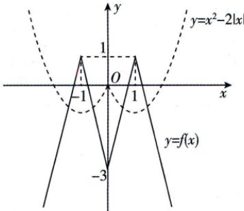

> [!faq]- 2026版 高中必刷题数学必修第一册
> **【解析】**
> $(-3,2)$ 【解析】由题意可知函数 $f(x)$ ， $g(x)$ 均为偶函数，且 $f(x)=1-||4x|-4|$ ，在同一平面直角坐标系中分别作出 $y=f(x),y=x^{2}-2|x|$ 的图象，则方程 $f(x)=g(x)$ 有4个实数解等价于 $f(x)$ 与 $g(x)$ 的图象有4个交点，即 $\left\{\begin{aligned}g(0)>f(0),\\ g(1)<f(1),\end{aligned}\right.$ 解得-3<m<2，所以实数m的取值范围为 $(-3,2)$ .
> 
