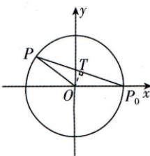

> [!faq]- 必刷题解析
> **【答案】** C
>
> **【解析】**
> 由题意可知,一个质点在圆 O 上每 5 s 逆时针转一圈,2 s 后,到达 P 点,所以 $\angle POP_{0}=\frac{4\pi}{5}$ , 而在 $\triangle POP_{0}$ 中, OP= $OP_{0}=2$ 且为圆的半径,取 $P_{0}P$ 的中点 T, 连接 OT, 如图,
>
> ---
> **🔔 敲黑板**
> 在圆中求弦长构造直角三角形求解

则 $\angle POT = \frac{2\pi}{5}$ , 所以 $\sin \angle POT = \frac{PT}{OP} = \sin \frac{2\pi}{5}$ , 则 $PT = \frac{1}{2} PP_0 = 2\sin \frac{2\pi}{5}$ , 所以 $PP_0 = 4\sin \frac{2\pi}{5}$ , 故选 C.

对应题目：[Q070000006065](../Q070000006065.md)

> 来源：2026版 高中必刷题数学必修第一册
