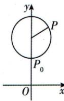

> [!faq]- 必刷题解析
> **【解析】**
> （1）【解】由振幅为2，A>0，可得A=2， $f(x)=2\sin\left(\frac{2\pi}{3}x+\varphi\right)$ 由噪声声波曲线经过点(1,-2)，得-2= $2\sin\left(\frac{2\pi}{3}+\varphi\right)\Rightarrow\sin\left(\frac{2\pi}{3}+\varphi\right)=-1,$ 而 $0 \leqslant \varphi < \pi, \frac{2\pi}{3} + \varphi \in \left[\frac{2\pi}{3}, \frac{5\pi}{3}\right)$ ,
则 $\frac{2\pi}{3}+\varphi=\frac{3\pi}{2}\Rightarrow\varphi=\frac{5\pi}{6}$ ,
则 $f(x)=2\sin\left(\frac{2\pi}{3}x+\frac{5\pi}{6}\right)$ .
又降噪声波曲线与噪声声波曲线的振幅相同、相位相反，
所以 $g(x)=-2\sin\left(\frac{2\pi}{3}x+\frac{5\pi}{6}\right)$ .
(2)【证明】由(1) $g(x)=-2\sin\left(\frac{2\pi}{3}x+\frac{5\pi}{6}\right)$ $=-2\sin\left(\frac{2\pi}{3}x+\frac{\pi}{3}+\frac{\pi}{2}\right)$ $=-2\cos\left(\frac{2\pi}{3}x+\frac{\pi}{3}\right)$ 则 $g(x)+g(x+1)+g(x+2)$ $=-2\cos\left(\frac{2\pi}{3}x+\frac{\pi}{3}\right)-2\cos\left(\frac{2\pi}{3}x+\pi\right)-2\cos\left(\frac{2\pi}{3}x+\frac{2\pi}{3}+\pi\right)$ $= -2\cos\left(\frac{2\pi}{3}x+\frac{\pi}{3}\right) + 2\cos\frac{2\pi x}{3} + 2\cos\left(\frac{2\pi}{3}x+\frac{2\pi}{3}\right)$
$= -2\left(\cos \frac{2\pi x}{3}\cdot \frac{1}{2} -\sin \frac{2\pi x}{3}\cdot \frac{\sqrt{3}}{2}\right) +$ $2\cos \frac{2\pi x}{3} +2\left[\cos \frac{2\pi x}{3}\cdot \left(-\frac{1}{2}\right) - \sin \frac{2\pi x}{3}\cdot$ $\frac{\sqrt{3}}{2} ]$ $= -\cos \frac{2\pi x}{3} +\sqrt{3}\sin \frac{2\pi x}{3} +2\cos \frac{2\pi x}{3}-$ $\cos \frac{2\pi x}{3} -\sqrt{3}\sin \frac{2\pi x}{3} = 0,$ 即 $g(x) + g(x + 1) + g(x + 2)$ 为定值0.

对应题目：[Q070000006351](../Q070000006351.md)

> 来源：2026版 高中必刷题数学必修第一册
