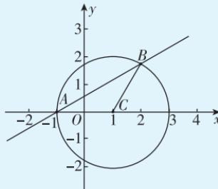

> [!faq]- 答案与解析
>
> > [!success]- **【答案】** 2或-2或 $\frac{1}{2}$ 或 $-\frac{1}{2}$ （填一个即可）
>
> > [!note]- **【解析】**
> > 由题知， $\odot C$ 的半径 $r = 2$ ，圆心 $C(1,0)$ .设圆心 $C$ 到直线 $x - my + 1 = 0$ 的距离为 $d$ ，则弦长 $\mid AB\mid =$ $2\sqrt{4 - d^2}$ ，所以 $S_{\triangle ABC} = \frac{1}{2}\times 2\sqrt{4 - d^2}$ $d=\frac{8}{5}$ ，解得 $d^{2}=\frac{4}{5}$ 或 $d^{2}=\frac{16}{5}$ ，所以 $d=\frac{2\sqrt{5}}{5}$ 或 $d=\frac{4\sqrt{5}}{5}$ 。由点到直线的距离公式可知，当 $d=\frac{2\sqrt{5}}{5}$ 时， $\frac{2}{\sqrt{m^{2}+1}}=\frac{2\sqrt{5}}{5}$ ，解得 $m=\pm2$ ；当 $d=\frac{4\sqrt{5}}{5}$ 时， $\frac{2}{\sqrt{m^{2}+1}}=\frac{4\sqrt{5}}{5}$ ，解得 $m=\pm\frac{1}{2}$ 。综上， $m=\pm2$ 或 $\pm\frac{1}{2}$ 。
> >
> > 多种解法 由题知, $\odot C$ 的半径 $r = 2$ , 圆心 $C(1,0)$ , 圆心 $C$ 到直线 $x - my + 1 = 0$ 的距离 $\frac{2}{\sqrt{m^2 + 1}} < 2$ , 所以 $m \neq 0$ . 直线方程 $x - my + 1 = 0$ 可化为 $y = \frac{1}{m} (x + 1)$ , 所以直线的斜率为 $\frac{1}{m}$ 且过定点 $(-1,0)$ . 因为点 $(-1,0)$ 在 $\odot C$ 上, 设为 $A$ (如图), 所以 $S_{\triangle ABC} = \frac{1}{2}|AC||y_B| = \frac{8}{5}$ , 解得 $|y_B| = \frac{8}{5}$ , 所以点 $B$ 的纵坐标为 $\pm \frac{8}{5}$ . 代入 $\odot C$ 方程, 得 $(x - 1)^2 + \frac{64}{25} = 4$ , 解得点 $B$ 坐标为 $\left(\frac{11}{5}, \frac{8}{5}\right)$ 或 $\left(\frac{11}{5}, -\frac{8}{5}\right)$ 或 $\left(-\frac{1}{5}, \frac{8}{5}\right)$ 或 $\left(-\frac{1}{5}, -\frac{8}{5}\right)$ . 因为 $A(-1,0)$ , 所以直线 $AB$ 的斜率为 $\pm \frac{1}{2}$ 或 $\pm 2$ , 故 $m = \pm 2$ 或 $\pm \frac{1}{2}$ .
> >
> > 
> >
> > ## 刷原创

对应题目：[Q070000006880](../Q070000006880.md)

> 来源：2027版 必刷题 数学选择性必修第一册RJA
