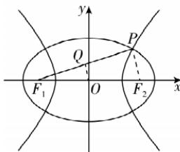

> [!faq]- 2027版 必刷题 数学选择性必修第一册RJA
>
> > [!success]- **【答案】** $\frac{3 + 2\sqrt{2}}{2}$
>
> > [!note]- **【解析】**
> > 设 $F_{2}$ 为右焦点，连接 $PF_{2}$ ，设半焦距为 $c, |PF_{1}| = x$ ， $|PF_{2}| = y$ ，设 $Q$ 为 $PF_{1}$ 的中点，连接 $OQ$ ，由线段 $PF_{1}$ 的垂直平分线经过坐标原点，可知 $OQ \perp PF_{1}$ ，又 $O$ 为 $F_{1}F_{2}$ 的中点，则 $OQ // PF_{2}$ ，所以 $PF_{1} \perp PF_{2}$ ，则 $x^{2} + y^{2} = 4c^{2}, x + y = 2a_{1}, x - y = 2a_{2}$ ，即 $x = a_{1} + a_{2}, y = a_{1} - a_{2}$ ，所以 $(a_{1} + a_{2})^{2} + (a_{1} - a_{2})^{2} = 4c^{2}$ ，所以 $(2a_{1})^{2} + (2a_{2})^{2} = 2 \times 4c^{2}$ ，从而有 $\frac{1}{e_1^2} + \frac{1}{e_2^2} = 2$
> >
> > 点悟：根据离心率公式 $e = \frac{c}{a}$ ，配凑出相应形式
> > 故 $2e_1^2 + e_2^2 = \frac{1}{2}(2e_1^2 + e_2^2)\left(\frac{1}{e_1^2} + \frac{1}{e_2^2}\right) = \frac{1}{2}\left(3 + \frac{2e_1^2}{e_2^2} + \frac{e_2^2}{e_1^2}\right) \geqslant \frac{1}{2}\left(3 + 2\sqrt{\frac{2e_1^2}{e_2^2} \cdot \frac{e_2^2}{e_1^2}}\right) = \frac{3 + 2\sqrt{2}}{2}$ ，当且仅当 $\frac{2e_1^2}{e_2^2} = \frac{e_2^2}{e_1^2}$ ，即 $e_2^2 = \sqrt{2} e_1^2 = \frac{1 + \sqrt{2}}{2}$ 时取等号，所以 $2e_1^2 + e_2^2$ 的最小值为 $\frac{3 + 2\sqrt{2}}{2}$ .
> >
> > 
