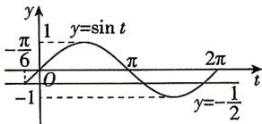

> [!faq]- 答案与解析
>
> > [!success]- **【答案】** ACD
>
> > [!note]- **【解析】**
> > ACD 【解析】由于 $f(x) = 2\cos^2\left(x - \frac{\pi}{3}\right) -$
> >
> > $2\cos\left(x+\frac{\pi}{4}\right)\sin\left(x+\frac{5\pi}{4}\right)-1=\cos\left(2x-\frac{2\pi}{3}\right)+2\cos\left(x+\frac{\pi}{4}\right)\sin\left(x+\frac{\pi}{4}\right)=\frac{\sqrt{3}}{2}\sin 2x-\frac{1}{2}\cos 2x+\sin\left(2x+\frac{\pi}{2}\right)=\frac{\sqrt{3}}{2}\sin 2x-\frac{1}{2}\cos 2x+\cos 2x=\frac{\sqrt{3}}{2}\sin 2x+\frac{1}{2}\cos 2x=\sin\left(2x+\frac{\pi}{6}\right).$ 对于 A, $f(x)$ 的最小正周期 $T=\frac{2\pi}{2}=\pi$ ，故 A 正确；
> > 对于 B, 令 $2x + \frac{\pi}{6} = k\pi + \frac{\pi}{2}, k \in Z$ ，解得 $x = \frac{k\pi}{2} + \frac{\pi}{6}, k \in Z$ ，令 $\frac{\pi}{3} = \frac{k\pi}{2} + \frac{\pi}{6}$ 得 $k = \frac{1}{3} \notin Z$ ，所以直线 $x = \frac{\pi}{3}$ 不是函数 $f(x)$ 图象的对称轴，故 B 错误；
> > 对于 C, 令 $-\frac{\pi}{2} + 2k\pi \leqslant 2x + \frac{\pi}{6} \leqslant \frac{\pi}{2} + 2k\pi, k \in Z$ ，可得 $-\frac{\pi}{3} + k\pi \leqslant x \leqslant \frac{\pi}{6} + k\pi, k \in Z,$ 所以函数 $f(x)$ 的单调递增区间为 $\left[-\frac{\pi}{3}+k\pi,\frac{\pi}{6}+k\pi\right], k \in Z,$ 故 C 正确；
> > 对于 D, 若函数 $g(x)=f(x)-k$ 有两个不同的零点，
> > 则曲线 $y = \sin\left(2x + \frac{\pi}{6}\right)$ 与直线 y = k 在区间 $\left[-\frac{\pi}{6}, \frac{11}{12}\pi\right]$ 上有两个不同的交点，
> > 由 $x \in \left[-\frac{\pi}{6}, \frac{11}{12}\pi\right]$ ，得 $2x + \frac{\pi}{6} \in \left[-\frac{\pi}{6}, 2\pi\right]$ .
> > 设 $t=2x+\frac{\pi}{6}, y=\sin t, t\in\left[-\frac{\pi}{6},2\pi\right]$ ,
> > 作出函数 y=sin t 的图象如图所示，
> >
> > 
> >
> > 由图可知 $k \in \left(-1, -\frac{1}{2}\right) \cup (0, 1)$ . 故 D 正确.
> >
> > 故选 **ACD**.

对应题目：[Q070000008197](../Q070000008197.md)

> 来源：2027版 高中必刷题数学必修第一册RJA
