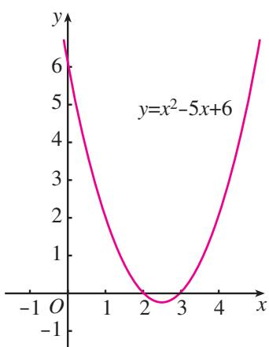

# 例 1 求判别式大于零的一元二次不等式的解集·解析

对应题目：[例 1 求判别式大于零的一元二次不等式的解集](../Q070000008469.md)

分析：因为方程 $x^{2}-5x+6=0$ 的根是函数 $y=x^{2}-5x+6$ 的零点，所以先求出 $x^{2}-5x+6=0$ 的根，再根据函数图象得到 $x^{2}-5x+6>0$ 的解集.

解：对于方程 $x^{2} - 5x + 6 = 0$ ，因为 $\Delta >0$ ，所以它有两个实数根．解得 $x_{1} = 2$ ， $x_{2} = 3$

画出二次函数 $y=x^{2}-5x+6$ 的图象（图 2.3-2），结合图象得不等式 $x^{2}-5x+6>0$ 的解集为 $\{x|x<2, \text{或 }x>3\}$ .

  
图2.3-2

## 所属组织

- [2.3 二次函数与一元二次方程、不等式](../../%E9%A2%98%E5%9E%8B/%E6%8C%89%E7%AB%A0%E8%8A%82%E5%88%86%E7%B1%BB/%E4%BA%BA%E6%95%99A-%E5%BF%85%E4%BF%AE%E7%AC%AC%E4%B8%80%E5%86%8C/%E7%AC%AC%E4%BA%8C%E7%AB%A0%20%E4%B8%80%E5%85%83%E4%BA%8C%E6%AC%A1%E5%87%BD%E6%95%B0%E3%80%81%E6%96%B9%E7%A8%8B%E5%92%8C%E4%B8%8D%E7%AD%89%E5%BC%8F/2.3%20%E4%BA%8C%E6%AC%A1%E5%87%BD%E6%95%B0%E4%B8%8E%E4%B8%80%E5%85%83%E4%BA%8C%E6%AC%A1%E6%96%B9%E7%A8%8B%E3%80%81%E4%B8%8D%E7%AD%89%E5%BC%8F.md)
