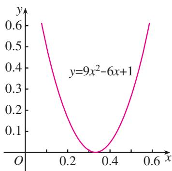

> [!faq]- 人教A版高中数学·必修第一册
> 解：对于方程 $9x^{2}-6x+1=0$ ，因为 $\Delta=0$ ，所以它有两个相等的实数根，解得 $x_{1}=x_{2}=\frac{1}{3}$ .
>
> 画出二次函数 $y = 9x^{2} - 6x + 1$ 的图象（图2.3-3），结合图象得不等式 $9x^{2} - 6x + 1 > 0$ 的解集为 $\{x \mid x \neq \frac{1}{3}\}$ .
>
> 
