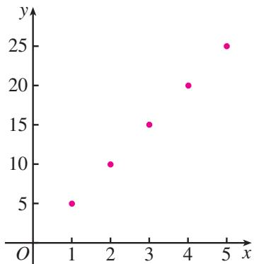

> [!faq]- 人教A版高中数学·必修第一册
> 解：这个函数的定义域是数集 $\{1,2,3,4,5\}$ .
>
> 用解析法可将函数 $y = f(x)$ 表示为
>
> $$
> y = 5 x, x \in \{1, 2, 3, 4, 5 \}.
> $$
>
> 用列表法可将函数 $y = f(x)$ 表示为
>
> <table><tr><td>笔记本数x</td><td>1</td><td>2</td><td>3</td><td>4</td><td>5</td></tr><tr><td>钱数y</td><td>5</td><td>10</td><td>15</td><td>20</td><td>25</td></tr></table>
>
> 用图象法可将函数 $y=f(x)$ 表示为图 3.1-2.
>
> 
> 图3.1-2
>
> ?
>
> 函数图象既可以是光滑的曲线，也可以是直线、折线、离散的点等。那么判断一个图形是不是函数图象的依据是什么？
