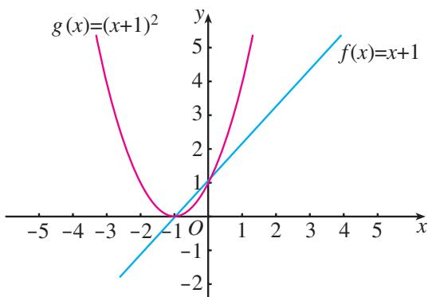
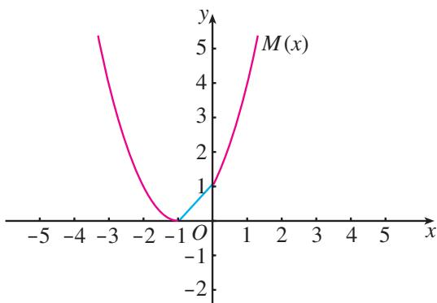

> [!faq]- 人教A版高中数学·必修第一册
> 解：（1）在同一直角坐标系中画出函数 $f(x)$ ， $g(x)$ 的图象（图3.1-4）.
>
> 
> 图3.1-4
>
> 
> 图3.1-5
>
> （2）由图3.1-4中函数取值的情况，结合函数 $M(x)$ 的定义，可得函数 $M(x)$ 的图象（图3.1-5).
>
> 由 $(x+1)^{2}=x+1$ ，得 $x(x+1)=0$ 。
>
> 解得 x = -1，或 x = 0。
>
> 结合图3.1-5，得出函数 $M(x)$ 的解析式为
>
> $$
> M (x) = \left\{ \begin{array}{l l} (x + 1) ^ {2}, & x \leqslant - 1, \\ x + 1, & - 1 <   x \leqslant 0, \\ (x + 1) ^ {2}, & x > 0. \end{array} \right.
> $$
>
> 你能用其他方法求出 $M(x)$ 的解析式吗？
