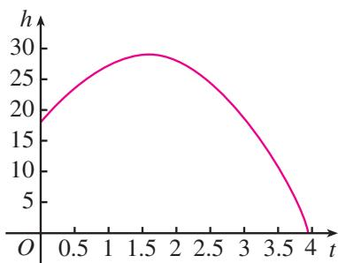

> [!faq]- 人教A版高中数学·必修第一册
> 解：画出函数 $h(t)=-4.9t^{2}+14.7t+18$ 的图象（图 3.2-4）. 显然，函数图象的顶点就是烟花上升的最高点，顶点的横坐标就是烟花爆竹裂的最佳时刻，纵坐标就是这时距地面的高度.
>
> 
>
> 
> 图3.2-4
>
> 烟花设计者就是按照这些数据设定引火线的长度，以达到施放烟花的最佳效果.
>
> 由二次函数的知识，对于函数 $h(t) = -4.9t^2 + 14.7t + 18$ ，我们有：
>
> 当 $t = -\frac{14.7}{2 \times (-4.9)} = 1.5$ 时，函数有最大值
>
> $$
> h = \frac {4 \times (- 4 . 9) \times 1 8 - 1 4 . 7 ^ {2}}{4 \times (- 4 . 9)} \approx 2 9.
> $$
>
> 于是，烟花冲出后 1.5 s 是它爆裂的最佳时刻，这时距地面的高度约为 29 m.
