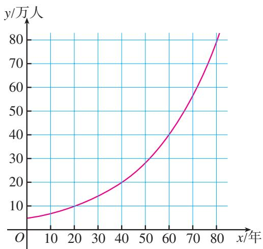

> [!faq]- 人教A版高中数学·必修第一册
> 分析：（1）因为该城市人口呈指数增长，而同一指数函数的倍增期是相同的，所以可以从图象中选取适当的点计算倍增期.
>
> （2）要计算20年后的人口数，关键是要找到20年与倍增期的数量关系.
>
> 解：（1）观察图 4.2-7，发现该城市人口经过20年约为10万人，经过40年约为20万人，即由10万人口增加到20万人口所用的时间约为20年，所以该城市人口每翻一番所需的时间约为20年.
>
> （2）因为倍增期为 20 年，所以每经过 20 年，人口将翻一番。因此，从 80 万人开始，经过 20 年，该城市人口大约会增长到 160 万人。
>
> 
> 图4.2-7
