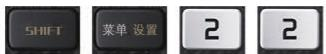
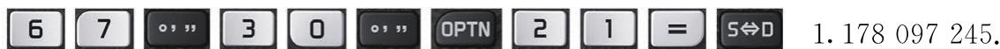

> [!faq]- 人教A版高中数学·必修第一册
> 解：（1）因为 $67^{\circ}30' = \left(\frac{135}{2}\right)^{\circ}$ ，所以
>
> $$
> 6 7 ^ {\circ} 3 0 ^ {\prime} = \frac {1 3 5}{2} \times \frac {\pi}{1 8 0} \mathrm{rad} = \frac {3}{8} \pi \mathrm{rad}.
> $$
>
> 公元6世纪，印度人在制作正弦表时，曾用同一单位度量半径和圆周，孕育着最早的弧度制概念。欧拉是明确提出弧度制思想的数学家。1748年，在他的一部划时代著作《无穷小分析概论》中，提出把圆的半径作为弧长的度量单位，使一个圆周角等于 $2\pi$ 弧度，1弧度等于周角的 $\frac{1}{2\pi}$ 。这一思想将线段与弧的度量统一起来，大大简化了三角公式及计算。
>
> (2) 利用计算器有
>
> 
>
> 0111
>
> 
>
> OPTN
>
> S⇔D
>
> 1.178 097 245.
>
> 因此， $67^{\circ}30^{\prime}\approx 1.178\mathrm{rad}.$
