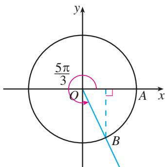

> [!faq]- 人教A版高中数学·必修第一册
> 解：在直角坐标系中，作 $\angle AOB = \frac{5\pi}{3}$ （图5.2-3). 易知 $\angle AOB$ 的终边与单位圆的交点坐标为 $\left(\frac{1}{2}, -\frac{\sqrt{3}}{2}\right)$ . 所以，
>
> $$
> \sin \frac {5 \pi}{3} = - \frac {\sqrt {3}}{2},
> $$
>
> 
> 图5.2-3
>
> $$
> \cos \frac {5 \pi}{3} = \frac {1}{2},
> $$
>
> $$
> \tan {\frac {5 \pi}{3}} = - \sqrt {3}.
> $$
