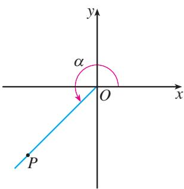
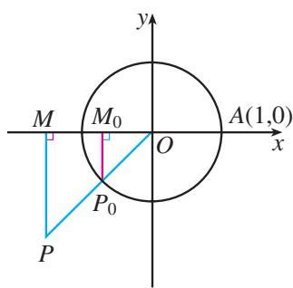

> [!faq]- 人教A版高中数学·必修第一册
> 分析：观察图5.2-5，由 $\triangle OMP\sim \triangle OM_0P_0$ ，根据三角函数的定义可以得到证明.
>
> 
>
> 证明：如图5.2-5，设角 $\alpha$ 的终边与单位圆交于点 $P_0(x_0, y_0)$ 。分别过点 $P$ ， $P_0$ 作 $x$ 轴的垂线 $PM$ ， $P_0M_0$ ，垂足分别为 $M$ ， $M_0$ ，则
>
> 图5.2-4
>
> $$
> \begin{array}{c} P _ {0} M _ {0} = | y _ {0} |, P M = | y |, \\ O M _ {0} = | x _ {0} |, O M = | x |, \\ \triangle O M P \sim \triangle O M _ {0} P _ {0}. \end{array}
> $$
>
> 于是
>
> $$
> \frac {P _ {0} M _ {0}}{1} = \frac {P M}{r},
> $$
>
> 
>
> 即
>
> $$
> \left| y _ {0} \right| = \frac {\left| y \right|}{r}.
> $$
>
> 图5.2-5
>
> 因为 $y_0$ 与 $y$ 同号，所以
>
> $$
> y _ {0} = \frac {y}{r},
> $$
>
> 即
>
> $$
> \sin \alpha = \frac {y}{r}.
> $$
>
> 同理可得
>
> $$
> \cos \alpha = \frac {x}{r}, \tan \alpha = \frac {y}{x}.
> $$
>
> 根据勾股定理， $r=\sqrt{x^{2}+y^{2}}$ ．由例2可知，只要知道角 $\alpha$ 终边上任意一点P的坐标，就可以求得角 $\alpha$ 的各个三角函数值，并且这些函数值不会随P点位置的改变而改变.
