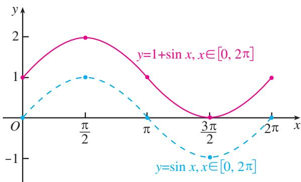
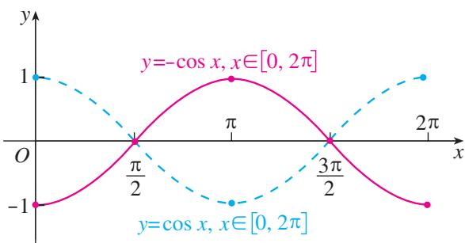

> [!faq]- 人教A版高中数学·必修第一册
> 解：（1）按五个关键点列表：
>
> <table><tr><td>x</td><td>0</td><td> $\frac{\pi}{2}$ </td><td>π</td><td> $\frac{3\pi}{2}$ </td><td>2π</td></tr><tr><td>sin x</td><td>0</td><td>1</td><td>0</td><td>-1</td><td>0</td></tr><tr><td>1+sin x</td><td>1</td><td>2</td><td>1</td><td>0</td><td>1</td></tr></table>
>
> 描点并将它们用光滑的曲线连接起来（图 5.4-6）：
>
> 
> 图5.4-6
>
> (2) 按五个关键点列表:
>
> <table><tr><td>x</td><td>0</td><td> $\frac{\pi}{2}$ </td><td>π</td><td> $\frac{3\pi}{2}$ </td><td>2π</td></tr><tr><td>cos x</td><td>1</td><td>0</td><td>-1</td><td>0</td><td>1</td></tr><tr><td> $-\cos x$ </td><td>-1</td><td>0</td><td>1</td><td>0</td><td>-1</td></tr></table>
>
> 描点并将它们用光滑的曲线连接起来（图 5.4-7）：
>
> 
> 图5.4-7
