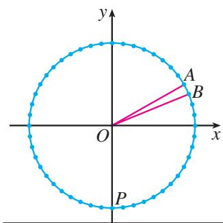

# 例 2 摩天轮座舱高度与相邻座舱高度差的三角函数建模·解析

对应题目：[例 2 摩天轮座舱高度与相邻座舱高度差的三角函数建模](../Q070000008906.md)

分析：摩天轮上的座舱运动可以近似地看作质点在圆周上做匀速旋转。在旋转过程中，游客距离地面的高度 $H$ 呈现周而复始的变化，因此可以考虑用三角函数来刻画。

解：如图 5.6-10，设座舱距离地面最近的位置为点 P，以轴心 O 为原点，与地面平行的直线为 x 轴建立直角坐标系.

（1）设 $t = 0\mathrm{min}$ 时，游客甲位于点 $P(0, -55)$ ，以 $OP$ 为终边的角为 $-\frac{\pi}{2}$ ；根据摩天轮转一周大约需要 $30\mathrm{min}$ ，可知座舱转动的角速度约为 $\frac{\pi}{15}\mathrm{rad / min}$ ，由题意可得

  
图5.6-10

$$
H = 5 5 \sin \left(\frac {\pi}{1 5} t - \frac {\pi}{2}\right) + 6 5, 0 \leqslant t \leqslant 3 0.
$$

(2) 当 t=5 时，

$$
H = 5 5 \sin \left(\frac {\pi}{1 5} \times 5 - \frac {\pi}{2}\right) + 6 5 = 3 7. 5.
$$

所以，游客甲在开始转动 5 min 后距离地面的高度约为 37.5 m.

（3）如图5.6-10，设甲、乙两人的位置分别用点 $A$ ， $B$ 表示，则 $\angle AOB = \frac{2\pi}{48} = \frac{\pi}{24}$ 经过 $t\min$ 后甲距离地面的高度为 $H_{1} = 55\sin \left(\frac{\pi}{15} t - \frac{\pi}{2}\right) + 65$ ，点 $B$ 相对于点 $A$ 始终落后 $\frac{\pi}{24}\mathrm{rad}$ ，此时乙距离地面的高度为 $H_{2} = 55\sin \left(\frac{\pi}{15} t - \frac{13\pi}{24}\right) + 65.$ 则甲、乙距离地面的高度差 $h = |H_1 - H_2| = 55\left|\sin \left(\frac{\pi}{15} t - \frac{\pi}{2}\right) - \sin \left(\frac{\pi}{15} t - \frac{13\pi}{24}\right)\right| = 55\left|\sin \left(\frac{\pi}{15} t - \frac{\pi}{2}\right) + \sin \left(\frac{13\pi}{24} -\frac{\pi}{15} t\right)\right|$ 利用 $\sin \theta +\sin \varphi = 2\sin \frac{\theta + \varphi}{2}\cos \frac{\theta - \varphi}{2}$ ，可得

238 第五章 三角函数

$$
h = 1 1 0 \left| \sin \frac {\pi}{4 8} \sin \left(\frac {\pi}{1 5} t - \frac {\pi}{4 8}\right) \right|, 0 \leqslant t \leqslant 3 0.
$$

当 $\frac{\pi}{15}t-\frac{\pi}{48}=\frac{\pi}{2}\left(\text{或}\frac{3\pi}{2}\right)$ ，即 $t\approx7.8$ （或22.8）时，h的最大值为 $110\sin\frac{\pi}{48}\approx7.2$ .
所以，甲、乙两人距离地面的高度差的最大值约为7.2m.

## 所属组织

- [5.6.2 函数 $y=A\sin(\omega x+\varphi)$ 的图象](../../%E9%A2%98%E5%9E%8B/%E6%8C%89%E7%AB%A0%E8%8A%82%E5%88%86%E7%B1%BB/%E4%BA%BA%E6%95%99A-%E5%BF%85%E4%BF%AE%E7%AC%AC%E4%B8%80%E5%86%8C/%E7%AC%AC%E4%BA%94%E7%AB%A0%20%E4%B8%89%E8%A7%92%E5%87%BD%E6%95%B0/5.6%20%E5%87%BD%E6%95%B0%20y%20%3D%20A%20sin%28%CF%89x%20%2B%20%CF%86%29.md)
