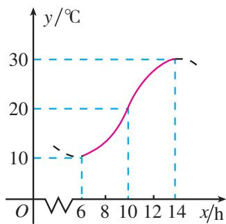

> [!faq]- 人教A版高中数学·必修第一册
> 解：（1）由图 5.7-3 可知，这段时间的最大温差是 $20^{\circ}$ C.
>
> (2) 由图 5.7-3 可以看出，从 6～14 时的图象是函数
>
> $$
> y = A \sin (\omega x + \varphi) + b
> $$
>
> 
>
> ①
>
> 的半个周期的图象，所以
>
> 图5.7-3
>
> $$
> A = \frac {1}{2} (3 0 - 1 0) = 1 0, b = \frac {1}{2} (3 0 + 1 0) = 2 0.
> $$
>
> 因为 $\frac{1}{2} \times \frac{2\pi}{\omega} = 14 - 6$ ，所以 $\omega = \frac{\pi}{8}$ .
>
> 将 $A = 10, b = 20, \omega = \frac{\pi}{8}, x = 6, y = 10$ 代入①式，可得 $\varphi = \frac{3\pi}{4}$ .
>
> 综上，所求解析式为
>
> $$
> y = 1 0 \sin \left(\frac {\pi}{8} x + \frac {3 \pi}{4}\right) + 2 0, x \in [ 6, 1 4 ].
> $$
>
> 一般地，所求出的函数模型只能近似刻画这天某个时段的温度变化情况，因此应当特别注意自变量的变化范围.
