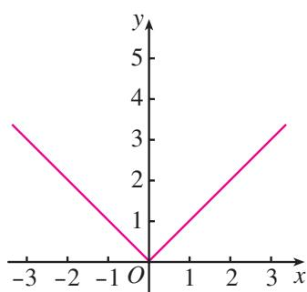

# 例 5 画出函数 $y=|x|$ 的图·解析

对应题目：[例 5 画出函数 $y=|x|$ 的图](../Q1221035528332426823.md)

解：由绝对值的概念，我们有

$$
y = \left\{ \begin{array}{l} - x, x <   0, \\ x, x \geqslant 0. \end{array} \right.
$$

所以，函数 $y=|x|$ 的图象如图 3.1-3 所示.

  
图3.1-3

像例5中 $y = \begin{cases} -x, & x < 0, \\ x, & x \geqslant 0 \end{cases}$ 这样的函数称为分段函数。生活中，有很多可以用分段函数描述的实际问题，如出租车的计费、个人所得税纳税额等。

## 所属组织

- [3.1.2 函数的表示法](../../%E9%A2%98%E5%9E%8B/%E4%BA%BA%E6%95%99A-%E5%BF%85%E4%BF%AE%E7%AC%AC%E4%B8%80%E5%86%8C/%E7%AC%AC%E4%B8%89%E7%AB%A0%20%E5%87%BD%E6%95%B0%E7%9A%84%E6%A6%82%E5%BF%B5%E4%B8%8E%E6%80%A7%E8%B4%A8/3.1%20%E5%87%BD%E6%95%B0%E7%9A%84%E6%A6%82%E5%BF%B5%E5%8F%8A%E5%85%B6%E8%A1%A8%E7%A4%BA/3.1.2%20%E5%87%BD%E6%95%B0%E7%9A%84%E8%A1%A8%E7%A4%BA%E6%B3%95.md)
