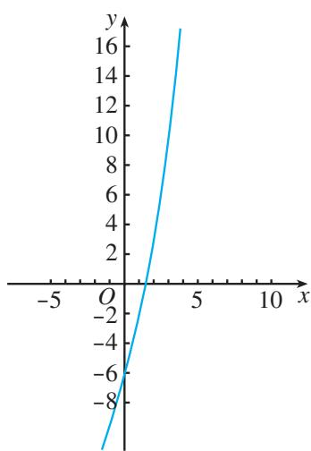
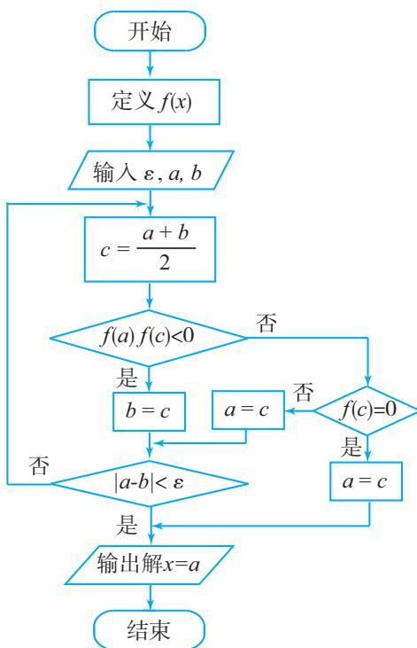

# 例 2 借助信息技术·解析

对应题目：[例 2 借助信息技术](../Q13172191043598781782.md)

解：原方程即 $2^{x}+3x-7=0$ ，令 $f(x)=2^{x}+3x-7$ ，用信息技术画出函数 $y=f(x)$ 的图象（图 4.5-4），并列出它的对应值表（表 4.5-3）.

表4.5-3

<table><tr><td>x</td><td>0</td><td>1</td><td>2</td><td>3</td><td>4</td><td>5</td><td>6</td><td>7</td><td>8</td></tr><tr><td>y</td><td>-6</td><td>-2</td><td>3</td><td>10</td><td>21</td><td>40</td><td>75</td><td>142</td><td>273</td></tr></table>

观察图 4.5-4 或表 4.5-3，可知 $f(1)f(2)<0$ ，说明该函数在区间 $(1,2)$ 内存在零点 $x_{0}$ .

图4.5-4

取区间（1，2）的中点 $x_{1} = 1.5$ ，用信息技术算得 $f(1.5)\approx 0.33.$ 因为 $f(1)f(1.5) <   0$ ，所以 $x_0\in$ (1,1.5).

再取区间（1，1.5）的中点 $x_{2} = 1.25$ ，用信息技术算得 $f(1.25)\approx -0.87$ 。因为 $f(1.25)f(1.5) < 0$ 所以 $x_0\in (1.25,1.5)$

同理可得， $x_0\in (1.375, 1.5)$ ， $x_0\in (1.375, 1.4375)$

由于

$$
\left| 1. 3 7 5 - 1. 4 3 7 5 \right| = 0. 0 6 2 5 <   0. 1,
$$

所以，原方程的近似解可取为1.375.

由例 2 可见，用二分法求方程的近似解，计算量较大，而且是重复相同的步骤。因此，可以通过设计一定的计算程序，借助信息技术完成计算。图 4.5-5 就是表示二分法求方程近似解过程的程序框图。有兴趣的同学，可以在此基础上用有关算法语言编写程序，利用信息技术求方程的近似解。

  
图4.5-5

## 所属组织

- [4.5.2 用二分法求方程的近似解](../../%E9%A2%98%E5%9E%8B/%E4%BA%BA%E6%95%99A-%E5%BF%85%E4%BF%AE%E7%AC%AC%E4%B8%80%E5%86%8C/%E7%AC%AC%E5%9B%9B%E7%AB%A0%20%E6%8C%87%E6%95%B0%E5%87%BD%E6%95%B0%E4%B8%8E%E5%AF%B9%E6%95%B0%E5%87%BD%E6%95%B0/4.5%20%E5%87%BD%E6%95%B0%E7%9A%84%E5%BA%94%E7%94%A8%EF%BC%88%E4%BA%8C%EF%BC%89/4.5.2%20%E7%94%A8%E4%BA%8C%E5%88%86%E6%B3%95%E6%B1%82%E6%96%B9%E7%A8%8B%E7%9A%84%E8%BF%91%E4%BC%BC%E8%A7%A3.md)
