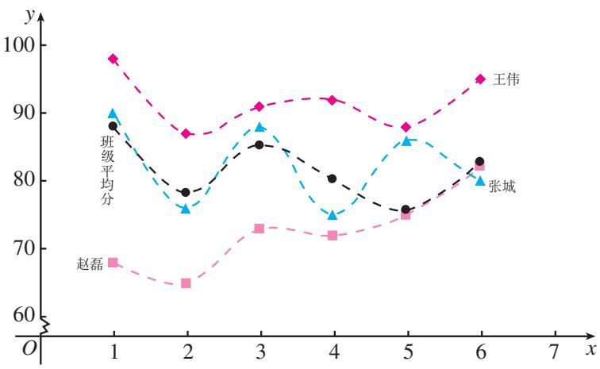

# 用函数表示成绩变化·解析

对应题目：[用函数表示成绩变化](../Q274522043026163346.md)

解：从表 3.1-4 中可以知道每位同学在每次测试中的成绩，但不太容易分析每位同学的成绩变化情况。如果将每位同学的“成绩”与“测试序号”之间的函数关系分别用图象（均为 6 个离散的点）表示出来，如图 3.1-6，那么就能直观地看到每位同学成绩变化的情况，这对我们的分析很有帮助。

从图3.1-6可以看到，王伟同学的数学学习成绩始终高于班级平均水平，学习情况比较稳定而且成绩优秀。张城同学的数学学习成绩不稳定，总是在班级平均水平上下波动，而且波动幅度较大。赵磊同学的数学学习成绩低于班级平均水平，但表示他成绩变化的图象呈上升趋势，表明他的数学成绩在稳步提高。

  
图3.1-6

为了更容易看出一个同学的学习情况，我们将表示每位同学成绩的函数图象（离散的点）用虚线连接.

## 所属组织

- [3.1.2 函数的表示法](../../%E9%A2%98%E5%9E%8B/%E4%BA%BA%E6%95%99A-%E5%BF%85%E4%BF%AE%E7%AC%AC%E4%B8%80%E5%86%8C/%E7%AC%AC%E4%B8%89%E7%AB%A0%20%E5%87%BD%E6%95%B0%E7%9A%84%E6%A6%82%E5%BF%B5%E4%B8%8E%E6%80%A7%E8%B4%A8/3.1%20%E5%87%BD%E6%95%B0%E7%9A%84%E6%A6%82%E5%BF%B5%E5%8F%8A%E5%85%B6%E8%A1%A8%E7%A4%BA/3.1.2%20%E5%87%BD%E6%95%B0%E7%9A%84%E8%A1%A8%E7%A4%BA%E6%B3%95.md)
